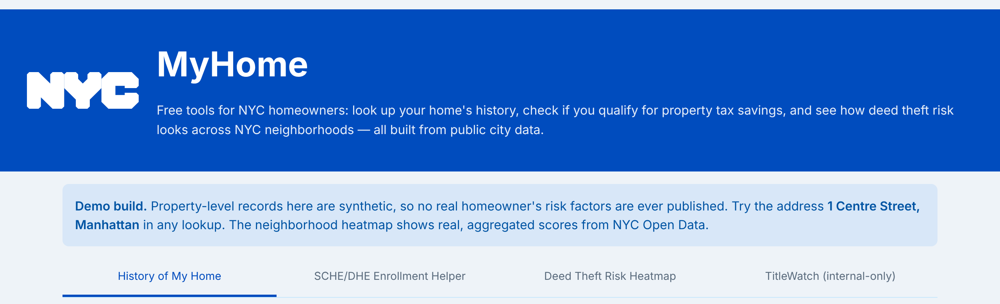
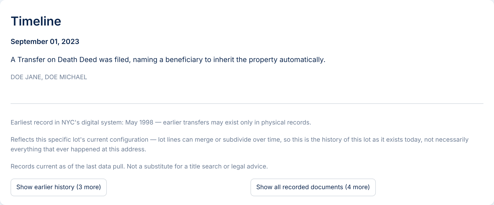
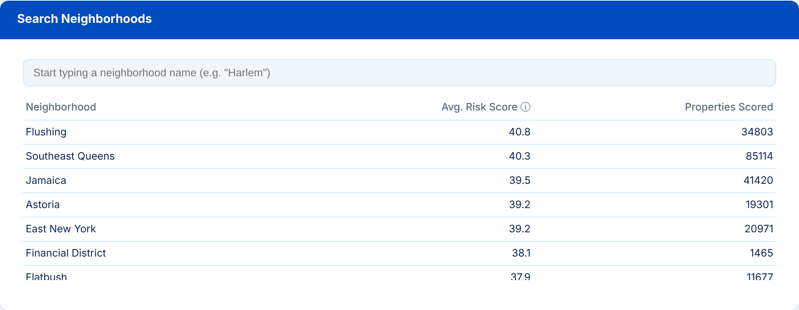
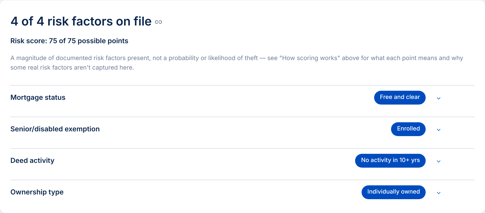

# MyHome: NYC Deed Theft Risk Index

Free tools that help NYC homeowners protect themselves from deed theft, built on public city data. Built solo in two days at the **"Built for NYC" AI Hackathon** at the New York Public Library (Stavros Niarchos Foundation Library, August 15 to 16, 2026), using Claude Code.

**[Try the live demo](https://myhome-nyc-3vbksjhshjuczkackjiheu.streamlit.app)** and look up **1 Centre Street, Manhattan**.



## The problem

Deed theft happens when someone forges or coerces a transfer of a home's title. In NYC it falls hardest on older, long-time homeowners in neighborhoods where prices are rising, and victims often find out only after the deed has changed hands. The city runs prevention programs, but nothing helps a homeowner, an heir, or an outreach worker see risk before it turns into a case.

There's also no public dataset of confirmed deed theft cases, so a fraud-prediction model isn't possible. MyHome is a **vulnerability index** instead: it counts documented risk factors that prosecutors and legal-aid groups keep seeing in real cases, and explains each one in plain language.

## What it does

| Tool | Who it's for | What it shows |
|---|---|---|
| **History of My Home** | Anyone | A plain-language ownership timeline for any address, built from ACRIS deed and mortgage records |
| **SCHE/DHE Enrollment Helper** | Homeowners | Whether a senior or disability property tax exemption is on file, plus a three-question eligibility screener. Answers are never stored |
| **Deed Theft Risk Heatmap** | Anyone | Average risk score by neighborhood, never by address |
| **TitleWatch** | City outreach staff (by design) | The risk factors on file for one property, with next steps |

**History of My Home** turns raw city filings into sentences a homeowner can read, bundles same-day documents, and says plainly what the records can't show.



**The heatmap** averages real scores across 233,303 properties in 12 neighborhoods.



**TitleWatch** lists each factor with a neutral status, a point total framed as a magnitude rather than a probability, and concrete protective steps.



## How it works

- **Data:** NYC Open Data through the Socrata API. ACRIS (deeds, mortgages, parties, references), PLUTO, DOF property exemptions, and rolling sales. NYC Geoclient turns an address into a tax lot (BBL).
- **Pipeline:** Python and DuckDB. About 1.37 million joined ACRIS filing rows feed a per-property table, then a weighted scorecard.
- **Scoring:** four factors, 75 points possible. A paid-off mortgage (no lender watching the title), a senior or disability exemption, no deed activity in 10+ years, and individual (not LLC) ownership. Weights and rationale are in [CLAUDE.md, Section 7](CLAUDE.md).
- **App:** Streamlit, styled with the NYC Opportunity design system's palette.

## Design decisions I'd defend in a review

- **Neighborhood price growth is left out of the score.** It's a real warning sign, but it tracks historically Black homeownership closely enough that scoring it would turn the map into a map of where Black homeowners live. That's a fair housing problem regardless of intent, so it stays as context only.
- **Individual risk data is never public.** A ranked list of "elderly, paid-off homes" is a target list for the people this tool works against. Public views stop at the neighborhood level. Property-level risk is designed as a staff-only tool for outreach teams, with every lookup logged.
- **Missing data isn't shown as good news.** Someone eligible for a senior exemption who never enrolled looks the same as someone who doesn't qualify. The UI says "Not on file," never a checkmark, and the Enrollment Helper exists to close that gap.
- **The SCHE screener asks for as little as possible.** It checks what city data already knows and asks only age or disability, residence, and an income bracket. Answers are never saved or tied to the address.

## How I built it

I planned and built this with Claude Code in a single weekend. [CLAUDE.md](CLAUDE.md) is the project's living spec: scope and cut list, data sources, join strategy, scoring rationale, fairness review, and dated decision reversals. Claude Code loads it at the start of every session, which kept a solo, AI-assisted build consistent across two days of fast changes.

## What's not built yet

Named plainly, as in the original demo:

- **Real authentication.** TitleWatch's staff-only access is a design. The hackathon build has no login, which is why the public demo uses synthetic property records.
- **Tax lien history.** The city's lien sale lists are downloaded, but matching them to properties isn't finished, so the factor is shown as "not part of the score yet."
- **Exemption lapse, vacancy signals, transaction-level anomaly scoring, and a fair housing legal review.** All scoped in CLAUDE.md as next steps.
- **Co-ops.** They face a different kind of fraud and aren't covered; the app says so.

## About the demo data

The public demo never publishes real property-level risk data. Property records in the deployed app are synthetic (owner names start with `DEMO:`), and only the neighborhood averages come from the real scoring run. The demo address is seeded to exercise every flow, so TitleWatch shows its senior exemption as enrolled while the Enrollment Helper treats it as not on file.

To rebuild the demo database after a real scoring run:

```bash
python scripts/build_deploy_db.py   # reads data/processed/, writes data/deploy/
python -m pytest tests/             # fails if any real property row slipped in
```

## Run it locally

```bash
python -m venv .venv && source .venv/bin/activate
pip install -r requirements.txt
cp .env.example .env               # add SOCRATA_APP_TOKEN and GEOCLIENT_PRIMARY_KEY
python scripts/ingest.py           # pull raw datasets to data/raw/
python scripts/build.py            # join and score into data/processed/
streamlit run deed_theft_index/app/main.py
```

Without a local scoring run, the app falls back to the committed demo database.

## Layout

```
deed_theft_index/
  config.py       dataset IDs, scope, scoring weights (single source of truth)
  ingest/         Socrata pulls, one module per dataset
  geocode/        Geoclient address to BBL lookup
  pipeline/       join.py (join sequence), score.py (scorecard)
  app/            Streamlit UI
scripts/          ingest, build, demo seeding, deploy DB build
tests/            guards on the committed demo database
```

## Related city resources

- [Mayor's Office of Deed Theft Prevention](https://www.nyc.gov/deedfraud)
- [ACRIS Notice of Recorded Documents (free alerts)](https://a836-acrissds.nyc.gov/NRD)

Built by Norm Robinson · [linkedin.com/in/normr](https://www.linkedin.com/in/normr)
